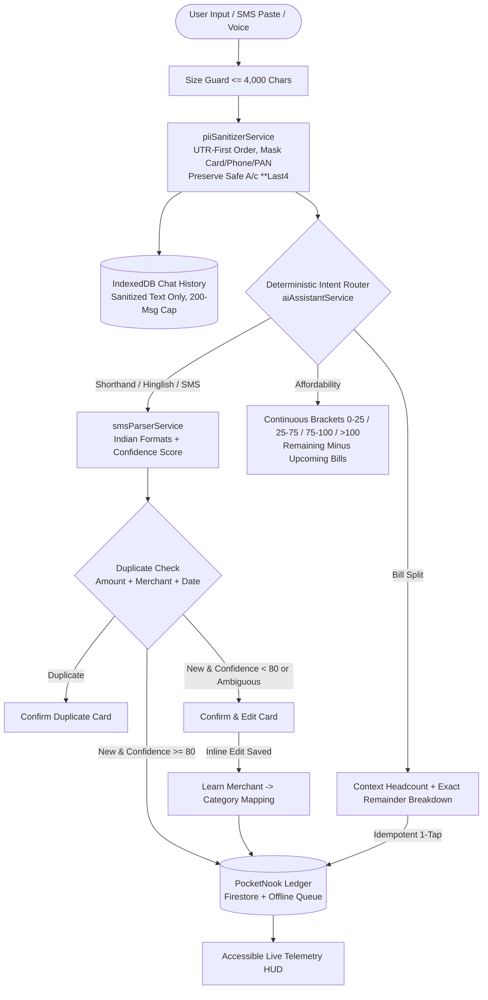

# PocketNook Chat (WhatsApp Assistant): Implementation & Design Specification

> **Document Status:** Updated Post-Review (P0 & P1 Hardened)  
> **Release Readiness:** Emulation Verified (Desktop & Mobile Viewports) · Real-Device Physical Android Verification Recommended Before Public Rollout  
> **Design Philosophy:** Luxury Fintech Mobile-First · Privacy-First Client-Side Masking  
> **Core Modules:** [WhatsAppChatboxModal.jsx](file:///d:/Expense%20Tracker/client/src/components/WhatsAppChatboxModal.jsx), [aiAssistantService.js](file:///d:/Expense%20Tracker/client/src/services/aiAssistantService.js), [smsParserService.js](file:///d:/Expense%20Tracker/client/src/services/smsParserService.js), [piiSanitizerService.js](file:///d:/Expense%20Tracker/client/src/services/piiSanitizerService.js), [chatStorageService.js](file:///d:/Expense%20Tracker/client/src/services/chatStorageService.js)

---

## 1. Executive Summary & Honest Architecture Boundaries

**PocketNook Chat** (Phase 1 in-app conversational assistant) streamlines expense logging and budget checks using deterministic parsing, confidence scoring, and structured financial formulas—without forcing users through nested forms.

### What Stays Local vs. What Syncs:
- **Local Masking (`piiSanitizerService.js`):** Sensitive numbers (UTR/RRN refs, card numbers, phone numbers, PAN, Aadhaar, email) are masked *before* text is stored in chat history or processed by reasoning functions. Long bank account numbers are masked to their low-risk last 4 digits (`A/c **4912`) for ledger reconciliation.
- **Chat History (`chatStorageService.js`):** Stored locally in **IndexedDB** (`pocketnook_chat_db`, partitioned by `userId`, capped at **200 messages**) using sanitized text only. Plaintext `localStorage` chat storage is purged.
- **Ledger Transactions (`api.js` / `offlineStorage.js`):** Confirmed expenses sync to your PocketNook ledger (**Firestore** when online, offline mutation queue when disconnected) with **last-write-wins conflict resolution** via `updated_at` timestamps.
- **Capabilities Clarification:** Phase 1 uses a **deterministic smart parser and financial rule engine** (not a general-purpose generative LLM unless optional backend proxy is enabled). Onboarding pills clearly demonstrate supported prompts in the initial view.

---

## 2. System Architecture & Data Flow

---

## 3. Visual & UX Design Specification

### 3.1 Themes, Contrast & Accessibility (WCAG AA)
- **Light, Dark & System Themes:** Full support for Light (`#f4f5fa` / `#ffffff`) and Dark Violet (`#0d0b18` / `#16132a`) plus user-configured themes via `ThemeContext`.
- **Contrast & Targets:** Borders use visible `border-slate-300/80 dark:border-violet-400/20`, high-contrast secondary text (`text-slate-600 dark:text-zinc-200`), and minimum **44×44px** (`w-11 h-11`) mobile touch targets for Back, Clear, Close, Mic, and Send buttons.
- **Color-Blind Safe HUD:** Status never relies on color alone—Remaining Pool pairs color with explicit icons and labels (`CheckCircle2` + `"Remaining"` vs `AlertTriangle` + `"Over"`).
- **Motion Sensitivity:** Respects `prefers-reduced-motion` (`motion-safe:` utilities and CSS media query disabling non-essential animations).

### 3.2 Mobile Keyboard, Gestures & Hardware Navigation
- **Dynamic Keyboard Pinning (`visualViewport`):** Listens to `window.visualViewport` resize events so the `82dvh` bottom sheet dynamically adapts when the mobile virtual keyboard opens, keeping the composer pinned with `.pb-safe` (`env(safe-area-inset-bottom)`).
- **Swipe-Down Gesture:** Touch-tracking on the top drag handle dismisses the drawer on a downward swipe (`> 70px`).
- **Android Hardware Back & Focus Management:** Opening the drawer pushes a lightweight `history` state token so hardware Back dismisses the drawer instead of navigating away. Modal implements `role="dialog"`, `aria-modal="true"`, `Tab` focus trapping, `Escape` dismissal, focus restoration on close, and `aria-live="polite"` on the message thread.
- **Dead Control Cleanup:** Removed disabled paperclip attachment button until Phase 2 receipt photo flow is active.

### 3.3 Onboarding, Contextual Chips & Inline Editing
- **Tappable Onboarding Examples:** Initial welcome state presents 4 one-tap pills (`"chai 20"`, `"split 1200 between 4"`, `"can i afford 3500?"`, `"chai pe 30 kharch kiya"`).
- **Contextual Chips:** Prompt chips update dynamically from conversation context (e.g., `Undo`, `Today's Total`, `Food Spend`) while retaining quick access to `Summary` and `Daily Pace`.
- **Proactive Nudges:** Alerts users when monthly spend crosses 80%, when one category dominates >50% of spend, or when identical recurring charges are detected twice.
- **Tappable Expense Cards & Learning:** Users can tap any logged expense card (or `"Edit Details"`) to edit Merchant, Amount, Category (including custom user categories), and Payment Mode inline. Saving updates the ledger and permanently learns `merchant -> category` preferences in IndexedDB.

---

## 4. Parser Hardening, Confidence & Financial Logic (P0 Fixes)

### 4.1 Number, Date & Hinglish Grammar
- **Comma-Safe Multi-Item Splitting:** Splits batches using `/(?<!\d),(?!\d)|,(?=\s)|[;\n]+|\s+\band\b\s+/i` so `50 chai, 1,200 lunch, 40 auto` preserves `1,200` cleanly.
- **Indian Amount Normalization (`parseIndianAmount`):** Parses `1,200`, `1,00,000`, `1.5k` (`₹1,500`), `2 lakh` (`₹2,00,000`), `1.2 cr`, and suffix currencies (`20 rs`, `20/-`).
- **Relative Dates (`extractDateFromText`):** Resolves `yesterday`/`kal`, `day before yesterday`/`parso`, `today`/`aaj`, `last Friday`, and `DD-MMM-YYYY`.
- **Hinglish Phrases:** Supports `chai pe 30 kharch kiya`, `200 ka petrol`, `lunch me 150 kharche`, `auto ke 40 diye`.
- **Quantity vs Amount Disambiguation:** Inputs like `2 chai 40` score `55%` confidence and trigger a Confirm card offering `Total ₹40 (2 Chai)` vs `2 × ₹40 = ₹80` instead of guessing.
- **Default Mode Inference:** Inferred payment mode defaults to the user's most frequently used mode in history (falling back to `UPI` when empty), explicitly tagged when inferred.

### 4.2 Confidence Thresholds & Duplicate Prevention
- **Confidence >= 80 & Non-Duplicate:** Logs immediately with Undo button, Undo toast notification, synced indicator, and inline Edit option.
- **Confidence < 80 or Ambiguous:** Renders a Confirm & Edit card before writing to the ledger.
- **Duplicate Guard:** Matches amount, normalized merchant similarity, and date before auto-logging; warns user with `"Log Anyway"` or `"Skip Duplicate"`.

### 4.3 Continuous Affordability Logic
Evaluates outlays against `freeSafePool = remainingBudget - upcomingRecurringCommitments`:
- Handles **No Budget Set**, **Already Overbudget**, **Encroaches on Upcoming Bills (`freeAfterPurchase < 0`)**, and **Final Day of Month**.
- Continuous coverage across all brackets:
  - `<= 25%` of free pool: **Comfortably Affordable**
  - `25% – 75%`: **Moderate Caution**
  - `75% – 100%`: **Tight Squeeze — High Impact**
  - `> 100%` (`newRemaining < 0`): **Budget Risk Detected**

### 4.4 Smart Bill Split & Idempotency
- Contextually extracts amount and headcount across `Split 2,400 among 6`, `2400.50 between 4`, `Divide 2500 by 3`, `Split 2400 6 ways`, and `Split 1800 with 4 friends`.
- Flags `"with N friends"` phrasing with a 1-tap toggle to split `N+1` ways including the user.
- Preserves exact total on uneven division (e.g., `2500 / 3` shows `1 × ₹834 + 2 × ₹833` exact breakdown).
- **"Log My Share" Idempotency:** First tap logs the share and immediately switches the button to **`Logged ✓ · Undo`** with click-lock protection against double taps.

### 4.5 Privacy Regex Ordering
To prevent numeric collisions, sanitization executes strictly in order:
1. **UPI/UTR/RRN/Txn Ref patterns FIRST** (prevents 12-digit UTRs from colliding with Aadhaar/Phone).
2. **Email, PAN, Aadhaar** (space/hyphen-delimited or labeled).
3. **16-digit / labeled Card digits**.
4. **Bank Account numbers** (masks long digits while preserving low-risk `A/c **XXXX`).
5. **Phone numbers** (guards against currency-prefixed figures like `Rs 9876543210.00`).
6. **Size Guard:** Input capped at `4,000` characters (resists 50k+ char ReDoS pastes cleanly).

---

## 5. Cultural Fit, Telemetry & Quality Signals

- **Customizable Allocation Presets:** Users can switch from standard `50/30/20` to Indian household-friendly `55/25/20 (EMI-Heavy)` or custom ratios, persisted in IndexedDB.
- **Informational Footer:** Financial planning cards (`50/30/20`, `Emergency Reserve`, `Debt`, `Investment`, `Goal Planning`) carry `"Informational estimate only — not regulated financial advice."`
- **Local Quality Telemetry (`chatStorageService.js`):** Tracks `logsCount`, `editCount` (`editRatePercent`), `undoCount` (`undoRatePercent`), `parseFailures`, and `avgTimeToLogMs` locally in IndexedDB to evaluate parser quality.

---

## 6. Phase 2 External WhatsApp Cloud API Roadmap & Risk Controls

When expanding to external WhatsApp messaging (`server/routes.js`), **all messages traverse Meta and PocketNook servers** (meaning client-only processing claims do NOT apply to Phase 2). Required Phase 2 safeguards:
1. **Webhook Security:** Enforce `X-Hub-Signature-256` HMAC verification on every `POST /api/whatsapp/webhook`, deduplicate retries via Meta `message.id`, and rate-limit one-time linking codes.
2. **Meta 24-Hour Policy & Cost Modeling:** Outbound messages outside the 24-hour customer care window must use pre-approved Meta utility templates (budget alerts, summaries) billed per conversation window.
3. **Privacy & DPDP Act 2023 Compliance:** Obtain explicit user consent before linking WhatsApp, disclose external message routing clearly, and mirror the exact `piiSanitizerService` scrubbing pipeline on the Node server before storage/LLM calls.
4. **Android Play Store Compliance:** Avoid auto-reading SMS permissions (restricted under Play Store Policy); prioritize Android **Share-sheet (`Share to PocketNook`)** and clipboard/paste workflows.
5. **Brand Separation:** Keep the in-app experience named **`PocketNook Chat`** to avoid WhatsApp trademark confusion.
