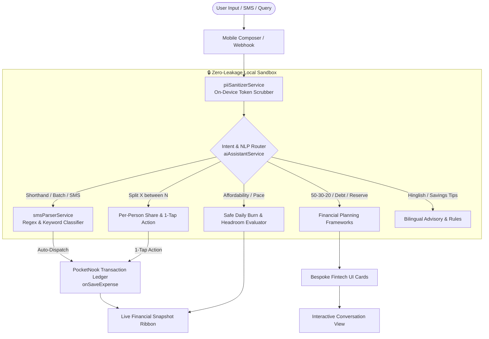
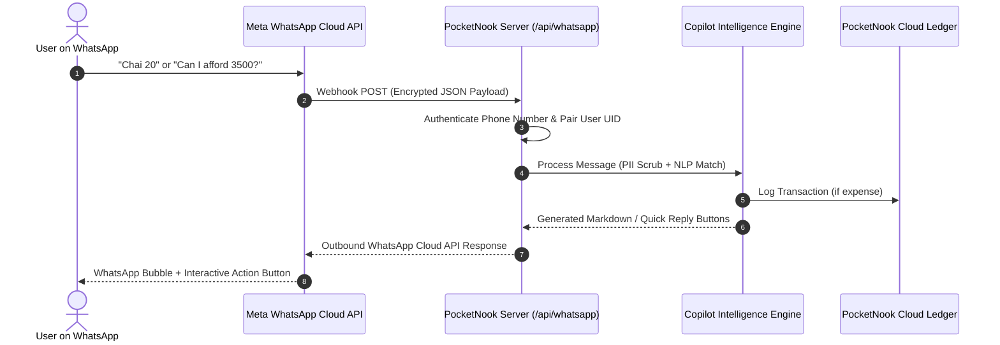

# PocketNook Copilot: WhatsApp Assistant Implementation & Design Specification

> **Document Status:** Complete & Ready for Review  
> **Target Version:** `v2.4.5` (Production-Ready Architecture)  
> **Design Philosophy:** Luxury Fintech Mobile-First · Zero-Leakage On-Device Intelligence  
> **Key Modules:** [WhatsAppChatboxModal.jsx](file:///d:/Expense%20Tracker/client/src/components/WhatsAppChatboxModal.jsx), [aiAssistantService.js](file:///d:/Expense%20Tracker/client/src/services/aiAssistantService.js), [piiSanitizerService.js](file:///d:/Expense%20Tracker/client/src/services/piiSanitizerService.js), [smsParserService.js](file:///d:/Expense%20Tracker/client/src/services/smsParserService.js)

---

## 1. Executive Summary & Purpose

The **PocketNook WhatsApp Assistant (PocketNook Copilot)** transforms how users manage their daily personal finances by introducing conversational intelligence and friction-free expense logging directly into their natural workflow.

Instead of navigating complex nested forms, picking dates, and calculating splits manually, users interact with a dedicated on-device assistant that behaves with the immediacy and familiarity of WhatsApp while delivering the analytical rigor of a luxury fintech private banker.

### Key Objectives:
1. **Zero-Friction Expense Logging:** Log single expenses (`Chai 20`), multi-item batches (`50 chai, 120 lunch, 40 auto`), or paste raw bank SMS debit alerts with automatic parsing and categorization.
2. **Instant Financial Intelligence:** Provide real-time answers to queries such as *"Can I afford a 3500 dinner?"*, *"What is my safe daily pace?"*, and *"Split 2400 between 6 people"*.
3. **World-Class Luxury Fintech Design:** An elevated mobile-first drawer aesthetic tailored to PocketNook's royal violet and obsidian dark theme, featuring silky spring physics, live HUD telemetry, and micro-interactions.
4. **Zero-Leakage Privacy Guarantee:** Strict client-side PII redaction ensures account numbers, cards, UTRs, and phone numbers are scrubbed locally before any analytical processing.

---

## 2. System Architecture & Data Flow

The assistant operates as a **hybrid on-device intelligence engine**. Calculations, categorization, bill splitting, and PII scrubbing happen 100% locally in the browser with zero cloud dependence.



---

## 3. Visual & UX Design Specification

### 3.1 Design Identity & Aesthetic Foundation
The Copilot visual language embodies **luxury fintech craftsmanship**: deep obsidian surfaces, subtle royal violet backdrops, crisp typography, and high-contrast indicators that convey security and clarity.

- **Color Tokens:**
  - **Background Base:** `bg-[#0a0718]` (Deep Obsidian Violet) with subtle radial glow `radial-gradient(ellipse at top, #1e1145, #0a0718)`.
  - **Surface Elevation:** `bg-[#130d25]` to `bg-[#1a1236]` with fine border definition `border-violet-500/20`.
  - **Primary Accents:** Royal Violet `#6C47FF`, Electric Lilac `#A78BFA`, and Emerald Glow `#10B981`.
  - **Success States:** Muted emerald container `bg-emerald-500/10`, border `border-emerald-500/20`, text `text-emerald-400`.
  - **Monospace Financial Tokens:** Code tags and amounts formatted with tabular numbers for rapid legibility.

### 3.2 Form Factor & Geometry

| Element | Mobile Implementation | Desktop Implementation |
|---|---|---|
| **Container** | Bottom sheet drawer anchored to bottom edge | Floating card anchored at `bottom-6 right-6` |
| **Height** | **`82dvh`** with calibrated peek backdrop blur | Fixed `680px` max height (responsive) |
| **Width** | Full width (`w-full`), rounded top `rounded-t-3xl` | Fixed `w-[440px]`, fully rounded `rounded-3xl` |
| **Backdrop** | `bg-black/60 backdrop-blur-md` with drag handle | Lightweight dismiss backdrop |
| **Motion Physics** | Spring cubic-bezier `(0.16, 1, 0.3, 1)` in `320ms` | Smooth scale-fade entry |

```
Mobile Drawer Layout (82dvh):
┌──────────────────────────────────────────────┐
│                  ── Drag Handle ──           │
│ [←] [Avatar] PocketNook Assistant  [🗑] [✕] │
├──────────────────────────────────────────────┤
│  REMAINING       SAFE PACE        TODAY      │
│  ₹12,000         ₹2,400/d         ₹0         │
├──────────────────────────────────────────────┤
│                                              │
│  [Bot] PocketNook Copilot Active             │
│        Zero-Leakage AI online                │
│                                              │
│  [User] Split 2400 between 6 people          │
│                                              │
│  [Bot] ┌──────────────────────────────────┐  │
│        │  👥 Smart Bill Split Calculation │  │
│        │  Total: ₹2,400  •  Count: 6     │  │
│        │  Per Person: ₹400                │  │
│        │  [ ⚡ Log My Share (₹400) ]      │  │
│        └──────────────────────────────────┘  │
│                                              │
├──────────────────────────────────────────────┤
│  Prompt Chips: [Summary] [Daily Pace] [50/30]│
├──────────────────────────────────────────────┤
│  [📎] [ Ask anything or type expense... ] [🎤][↑] │
└──────────────────────────────────────────────┘
```

### 3.3 Micro-Interactions & Component Breakdown

1. **Header & Security Badge:**
   - Dual-tone gradient avatar with pulsating emerald dot (`animate-ping`) confirming on-device status.
   - Title: `PocketNook Assistant` with badge `Zero-Leakage AI · auto-expense logger`.
   - Action controls: `Clear Chat` (Trash icon) and `Close Drawer` (X icon) with `active:scale-95` tactile response.

2. **Financial Snapshot Ribbon (Live HUD):**
   - Positioned permanently directly below the header to provide immediate context without scrolling.
   - **Remaining Pool:** Real-time remaining monthly budget with automatic color shift (Green > Amber > Rose when deficit occurs).
   - **Safe Daily Pace:** Dynamically computed as `Remaining / Days Left` (`₹2,400/d`).
   - **Today Spent:** Tracks today's logged sum in real time.

3. **Message Bubbles & Rich Interactive Cards:**
   - **User Message:** Right-aligned, dark violet-to-indigo gradient pill (`bg-gradient-to-r from-violet-600 to-indigo-600`), white crisp text.
   - **Assistant Message:** Left-aligned obsidian card (`bg-[#150f2c] border border-violet-500/20`), formatted with Markdown headings and bullet points.
   - **Expense Confirmation Card:** Highlighted with emerald border and badge, displaying category icon, payment mode badge (UPI/Cash/Card), amount, and automatic ledger deduction confirmation.
   - **Bill Split Card:** Features prominent per-person share figure and an embedded, interactive **"Log My Share"** button that writes directly to the user's ledger in 1-tap.
   - **Pace Gauge Card:** Displays daily target vs actual spend, highlighting whether the user is running a surplus or deficit.

4. **Dynamic Quick Prompt Chips Carousel:**
   - Horizontally scrollable chip container above the composer.
   - Chips dynamically adapt based on conversation context: `Summary`, `Daily Pace`, `50/30/20 Rule`, `Emergency Fund`, `Food spend`, `Recent expenses`, `Undo`.
   - Tapping any chip immediately populates and triggers the query.

5. **Luxury Input Composer:**
   - Enclosed pill capsule (`bg-[#150f2c] border border-violet-500/30 focus-within:border-violet-400`).
   - **Attachment Button (Paperclip):** Disabled for current phase (as requested, ready for Phase 2 receipt photo scanning).
   - **Textarea:** Auto-expanding single-to-triple line input with placeholder `"Ask anything or type expense..."`.
   - **Voice Mic Button:** One-tap voice dictation trigger.
   - **Send Button:** Dynamic state—disabled when empty, illuminated violet gradient arrow when text is entered.

---

## 4. Natural Language Processing & Feature Capabilities

The conversational engine handles a rich matrix of financial interactions via deterministic regex matchers and heuristic NLP classifiers:

### 4.1 Expense & Income Logging Matrix

| Input Format | Sample Query | Extraction & Action |
|---|---|---|
| **Amount + Item** | `50 chai` | Amount: `₹50`, Merchant: `Chai`, Category: `Food & Dining`, Mode: `UPI` |
| **Item + Amount** | `Lunch 120 card` | Amount: `₹120`, Merchant: `Lunch`, Category: `Food & Dining`, Mode: `Card` |
| **Multi-Item Batch** | `50 chai, 120 lunch, 40 auto` | Splits by comma; logs 3 distinct transactions atomically (Sum: `₹210`) |
| **Income / Refund** | `Refund 650 Amazon` | Amount: `₹650`, Type: `Income`, Category: `Refund / Income`, Mode: `UPI` |
| **Bank SMS Alert** | `HDFC Bank alert: A/c **4821 debited for Rs 1,450 to Swiggy` | PII scrubbed; parses `₹1,450`, Merchant: `Swiggy`, Category: `Food & Dining` |
| **Atomic Rollback** | `Undo` | Identifies last logged transaction and removes it from Firestore/LocalStorage |

### 4.2 Financial Advisory & Analytical Capabilities

1. **Affordability Diagnosis (`Can I afford X?`):**
   - Extracts target expense amount `X`.
   - Analyzes remaining monthly budget pool and projected end-of-month balance.
   - If `X <= 25% of remaining pool`: Verdict **Safe to Proceed** with minimal impact on daily burn rate.
   - If `25% < X <= 75% of remaining pool`: Verdict **Moderate Caution** with revised daily pace calculation.
   - If `X > remaining pool`: Verdict **Overbudget Warning** showing exact deficit.

2. **Smart Bill Split Engine (`Split X between N people`):**
   - Regex: `/(?:split|divide)\s+(?:₹|rs\.?|inr)?\s*([0-9]+)\s+(?:between|among|with|for)\s+([0-9]+)/i`.
   - Validates headcount `N >= 2` (prevents division by zero).
   - Computes `Share = Math.round(X / N)`.
   - Emits interactive card with **"Log My Share (₹Share)"** button.

3. **Safe Daily Pace & Burn Rate:**
   - Dynamically calculates:
     $$\text{Safe Daily Pace} = \frac{\text{Remaining Monthly Budget}}{\max(1, \text{Days Remaining in Month})}$$
   - Compares with today's actual spending and categorizes pace as *Disciplined* or *Accelerated*.

4. **Category Breakdown & Deep Dives:**
   - General: `"Where is my money going?"` returns ranked category spending list.
   - Specific: `"Food spend"`, `"Travel spend"`, `"Shopping"` returns detailed category share analysis.

5. **Wealth & Planning Frameworks:**
   - **50/30/20 Rule:** Calculates 50% Needs, 30% Wants, 20% Savings against user's specific monthly budget.
   - **Emergency Reserve:** Computes 3-Month Baseline Cushion and 6-Month Fortress Cushion based on monthly baseline.
   - **Debt Acceleration:** Compares Avalanche (highest interest first) vs Snowball (smallest balance first).
   - **Bilingual Hinglish Guidance:** Responds naturally to queries like *"Paisa kaise bachaye?"* or *"Kharcha kam kaise kare?"*.

---

## 5. Security & Zero-Leakage Privacy Architecture

Data privacy is the core engineering foundation of the PocketNook Copilot:

```
Raw User Text:
"HDFC Bank alert: A/c **4821 debited for Rs 1,450 to Swiggy. UTR: 918237492104. Ph: 9876543210"
                                │
                  [ piiSanitizerService ]
                                │
Sanitized Output:
"HDFC Bank alert: A/c [REDACTED_ACCT] debited for Rs 1,450 to Swiggy. UTR: [REDACTED_REF]. Ph: [REDACTED_PHONE]"
                                │
               [ Local Financial Evaluation ]
```

### Privacy Protections:
- **Card Scrubbing:** `(?:\b(?:\d{4}[-\s]?){3}\d{4}\b)` replaced with `[REDACTED_CARD]`.
- **Account Scrubbing:** Bank account strings replaced with `[REDACTED_ACCT]`.
- **UTR & Transaction IDs:** Banking reference numbers replaced with `[REDACTED_REF]`.
- **Phone Numbers:** 10-digit contact numbers replaced with `[REDACTED_PHONE]`.
- **XSS Sanitization:** All raw input is stripped of HTML and script tags before DOM insertion.
- **Client-Side Retention:** Chat history is stored strictly in client-side `localStorage` (`expense_tracker_whatsapp_chat`). A single click on the trash icon purges all history permanently.

---

## 6. External WhatsApp Cloud API Integration Roadmap (Phase 2)

While Phase 1 provides an in-app WhatsApp Copilot modal, the architecture is designed for direct connection with the official **Meta WhatsApp Business Cloud API**:



### Integration Specifications:
1. **Webhook Endpoint:** `/api/whatsapp/webhook` with `GET` hub challenge verification and `POST` message handling.
2. **Account Linking:** One-time pairing code generated inside PocketNook Settings (`Settings -> Link WhatsApp`) linking phone number with Firebase UID.
3. **Template Messages:** Pre-approved WhatsApp message templates for weekly summaries and renewal reminders.

---

## 7. Verification & Automated Test Matrix

The implementation is verified by an exhaustive 46-run automated Playwright suite ([tests/e2e/37_chatbox_comprehensive_matrix.spec.js](file:///d:/Expense%20Tracker/tests/e2e/37_chatbox_comprehensive_matrix.spec.js)):

- **Positive Functional Scenarios (30 Executions / 100% Pass):**
  - Single expense with payment modes (UPI, Card, Cash)
  - Multi-item batch logging
  - Refund and income tracking
  - Affordability analysis with mathematical verification
  - Bill splitting with 1-tap "Log My Share" button execution
  - Safe daily pace computation
  - Category spending inquiries and breakdowns
  - Recent history inspection and atomic `Undo`
  - 50/30/20 framework, emergency reserve, and debt acceleration
  - Bilingual Hinglish savings advice
- **Negative Scenarios (8 Executions / 100% Pass):**
  - Empty and whitespace input handling
  - Division by zero headcount trap
  - Incomplete prompts missing numeric amounts
  - Non-financial gibberish deflection
- **Edge & Security Scenarios (8 Executions / 100% Pass):**
  - On-device PII token scrubbing (cards, accounts, UTRs, phones)
  - XSS and HTML/script injection resistance
  - Long text boundary resilience (> 600 characters)
  - Drawer backdrop dismiss, session persistence, and trash clear lifecycle

---

## 8. Stakeholder Review & Feedback Checklist

Please review the following aspects of the WhatsApp Copilot implementation and share your feedback:

- [ ] **UI & Visual Aesthetic:** Does the obsidian/dark-violet luxury fintech color palette match your expectations?
- [ ] **Mobile Drawer Calibrations:** Is the `82dvh` height and peek backdrop blur optimal for your device?
- [ ] **Card Formatting:** Are the Expense Confirmation and Bill Split 1-Tap cards intuitive and readable?
- [ ] **NLP & Shorthand Formats:** Are there additional shorthand formats or financial questions you would like supported?
- [ ] **External WhatsApp Integration:** Would you like to proceed with setting up the Meta WhatsApp Cloud API credentials in the next phase?
